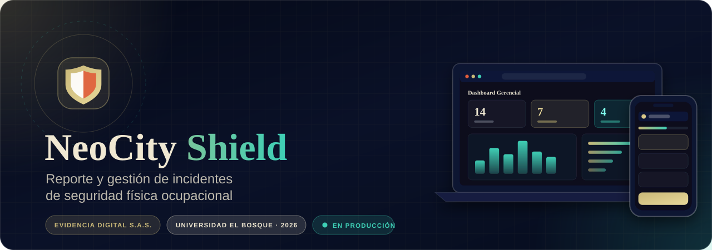
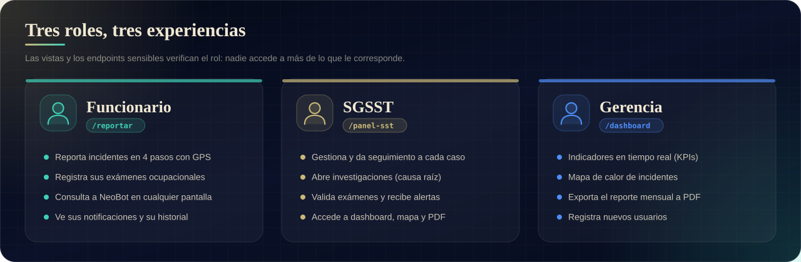
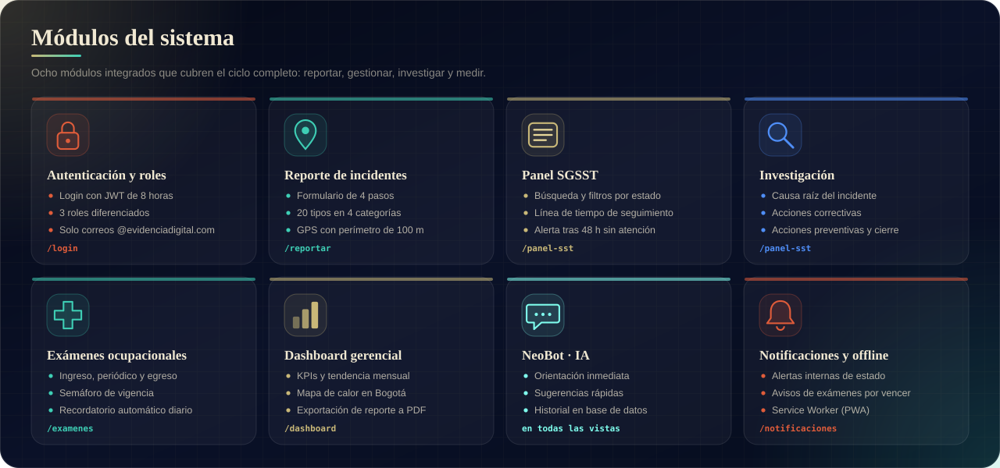
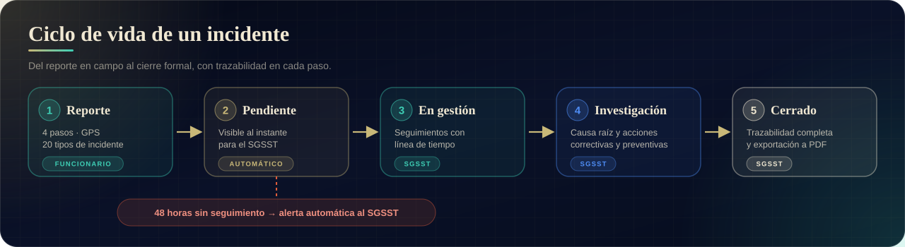
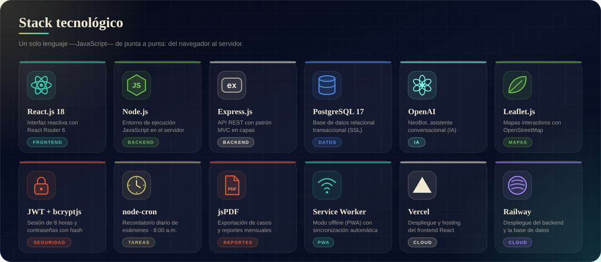
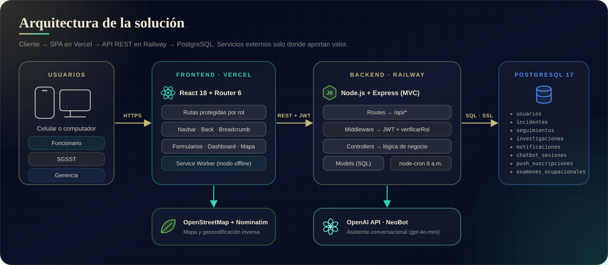
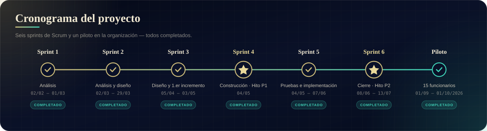

<p align="center">
  
</p>

<p align="center">
  <a href="https://neocity-shield.vercel.app"></a>
  <a href="https://neocity-shield-production.up.railway.app/api/health"></a>
  <a href="https://neocity-shield.vercel.app/mapa"></a>
</p>

<p align="center">
  <b>Beneficiario:</b> Evidencia Digital S.A.S. &nbsp;·&nbsp;
  <b>Universidad:</b> El Bosque — Trabajo de grado 2025–2026<br>
  <b>Equipo:</b> Daniel Moreno · Ricardo De León · Christiam Caita &nbsp;·&nbsp;
  <b>Director:</b> Cesar Ramiro Beltrán Hernández
</p>

---

## ✨ ¿Qué es NeoCity Shield?

Un sistema de información web que reemplaza el reporte informal de incidentes de seguridad física (WhatsApp, correos y hojas de Excel) por un **canal institucional único, trazable y accesible desde el celular o el computador**, sin instalar nada.

| Antes | Con NeoCity Shield |
|---|---|
| Tasa de reporte al SGSST cercana al 50 % | Reporte formal en 4 pasos, con GPS y mapa |
| Información dispersa en WhatsApp y Excel | Una sola base de datos con historial de seguimiento |
| Sin procesos estandarizados | Ciclo de vida definido: reporte → gestión → investigación → cierre |
| Cumplimiento parcial del Decreto 1072 de 2015 | Trazabilidad, investigación de causa raíz y control de exámenes ocupacionales |

---

## 🔗 Enlaces

| Recurso | URL |
|---|---|
| **Aplicación web** | https://neocity-shield.vercel.app |
| **API (backend)** | https://neocity-shield-production.up.railway.app |
| **Mapa de incidentes** | https://neocity-shield.vercel.app/mapa |
| **Repositorio** | https://github.com/neocityshield-jpg/neocity-shield |

---

## 👥 Roles

<p align="center">
  
</p>

El registro de cuentas está restringido a correos `@evidenciadigital.com` y solo el rol **Gerencia** puede crear usuarios nuevos.

---

## 🧩 Módulos

<p align="center">
  
</p>

<details>
<summary><b>Ver el detalle de cada módulo</b></summary>

### Autenticación y roles
- Login con JWT de 8 horas y contraseñas con hash bcrypt
- Tres roles diferenciados: **Funcionario**, **SGSST** y **Gerencia**
- Rutas protegidas en el frontend y verificación de rol en el backend

### Reporte de incidentes (Funcionario)
- Formulario de 4 pasos con barra de progreso
- 20 tipos de incidente en 4 categorías (ARL Sura / ISO 45001)
- Captura GPS con validación de perímetro de 100 metros
- Dirección exacta por geocodificación inversa (Nominatim)
- Mapa interactivo en tiempo real (Leaflet)

### Panel SGSST
- Vista centralizada de todos los incidentes con buscador y filtros por estado y fechas
- Historial de seguimientos con línea de tiempo e indicador de tiempo de respuesta
- Alerta automática para casos sin atención en 48 horas
- Exportación del caso individual a PDF
- **Investigación:** causa raíz, acciones correctivas y preventivas, y cierre

### Exámenes ocupacionales
- Auto-reporte del funcionario: fecha, tipo (ingreso, periódico, egreso) y soporte
- Próximo vencimiento calculado según la periodicidad del cargo
- Validación por SGSST (vigente o rechazado) con resultado: apto, apto con recomendaciones o no apto
- Panel `/examenes-sst` con buscador, filtros y semáforo (vigente · próximo a vencer · vencido · pendiente)
- Recordatorio automático diario a las 8:00 a.m. (hora Colombia) y resumen diario para SGSST
- Disparo manual del recordatorio para pruebas y sustentación

### Dashboard gerencial
- KPIs en tiempo real: total, pendientes, en gestión y cerrados
- Tendencia mensual y distribución por tipo de incidente
- Mapa de calor de incidentes en Bogotá
- Porcentaje de personal con exámenes al día y exámenes vencidos
- Exportación del reporte mensual a PDF

### NeoBot — asistente con IA
- Orientación inmediata ante hurtos, caídas, agresiones y amenazas
- Sugerencias rápidas y disponibilidad en todas las pantallas
- Historial de conversaciones en base de datos

### Perfil y notificaciones
- Estadísticas e historial de reportes propios
- Alertas internas por cambios de estado y por exámenes próximos a vencer

### Navegación, responsividad y modo offline
- Barra de navegación en todas las vistas: enlaces por rol, botón **Atrás**, ruta *Inicio / sección* y **Cerrar sesión** siempre visible
- Menú lateral en celular; diseño responsivo para móvil y escritorio
- Service Worker (PWA) para funcionar sin conexión y sincronizar al recuperar internet

</details>

---

## 🔄 Ciclo de vida de un incidente

<p align="center">
  
</p>

---

## 🛠️ Stack tecnológico

<p align="center">
  
</p>

| Capa | Tecnología | Plataforma |
|---|---|---|
| Frontend | React.js 18 + React Router 6 | Vercel |
| Backend | Node.js + Express.js (MVC) | Railway |
| Base de datos | PostgreSQL 17 | Railway |
| Inteligencia artificial | OpenAI (`gpt-4o-mini`) | API externa |
| Mapas | Leaflet.js + OpenStreetMap / Nominatim | — |
| Autenticación | JWT + bcryptjs | — |
| Tareas programadas | node-cron | — |
| Exportación | jsPDF + AutoTable | — |

---

## 🏗️ Arquitectura

<p align="center">
  
</p>

El backend sigue el patrón **MVC**: las rutas reciben la petición y aplican los middlewares de autenticación y rol; los controladores contienen la lógica y los modelos encapsulan las consultas SQL. El frontend consume la API desde un cliente HTTP central que inyecta el token JWT en cada petición.

<details>
<summary><b>📁 Estructura del repositorio</b></summary>

```bash
neocity-shield/
├── backend/
│   ├── config/
│   │   └── db.js                      # Conexión PostgreSQL con SSL
│   ├── jobs/
│   │   └── recordatorioExamenes.js    # Cron diario de exámenes ocupacionales
│   ├── models/
│   │   ├── Usuario.js
│   │   ├── Incidente.js
│   │   ├── Seguimiento.js
│   │   └── ExamenOcupacional.js
│   ├── controllers/
│   │   ├── authController.js
│   │   ├── incidenteController.js
│   │   ├── sstController.js
│   │   ├── dashboardController.js
│   │   ├── chatbotController.js
│   │   └── examenController.js
│   ├── middleware/
│   │   └── authMiddleware.js          # verificarToken · verificarRol
│   ├── routes/
│   │   ├── authRoutes.js
│   │   ├── incidenteRoutes.js
│   │   ├── sstRoutes.js
│   │   ├── dashboardRoutes.js
│   │   ├── chatbotRoutes.js
│   │   ├── notificacionRoutes.js
│   │   ├── investigacionRoutes.js
│   │   └── examenRoutes.js
│   ├── server.js
│   └── package.json
│
├── frontend/
│   ├── public/
│   │   ├── index.html
│   │   └── sw.js                      # Service Worker (modo offline)
│   └── src/
│       ├── index.js
│       ├── index.css                  # Sistema de diseño completo
│       ├── App.jsx                    # Rutas y control de acceso por rol
│       ├── context/AuthContext.jsx
│       ├── services/api.js
│       └── components/
│           ├── Login.jsx · Registro.jsx · Navbar.jsx
│           ├── FormReporte.jsx · PanelSST.jsx · Investigacion.jsx
│           ├── MisExamenes.jsx · ExamenesSST.jsx
│           ├── Dashboard.jsx · MapaCalor.jsx
│           └── Chatbot.jsx · Notificaciones.jsx · MiPerfil.jsx
│
└── docs/
    └── assets/                        # Imágenes de este README
```

</details>

<details>
<summary><b>🗄️ Modelo de datos</b></summary>

| Tabla | Descripción |
|---|---|
| `usuarios` | Funcionarios con rol y credenciales |
| `incidentes` | Reportes con geolocalización y estado |
| `seguimientos` | Historial de gestión por caso |
| `investigaciones` | Causa raíz y acciones correctivas / preventivas |
| `notificaciones` | Alertas internas del sistema |
| `chatbot_sesiones` | Historial de conversaciones con NeoBot |
| `push_suscripciones` | Suscripciones a notificaciones push |
| `examenes_ocupacionales` | Exámenes de ingreso, periódicos y de egreso: fechas, resultado, estado de validación y último recordatorio |

</details>

<details>
<summary><b>🔌 Endpoints de la API</b></summary>

Todas las rutas cuelgan de `/api`. Salvo `login` y el chatbot, requieren `Authorization: Bearer <token>`.

| Método | Ruta | Rol | Descripción |
|---|---|---|---|
| POST | `/auth/login` | Público | Inicia sesión y devuelve el JWT |
| POST | `/auth/registro` | Gerencia | Crea un usuario (solo `@evidenciadigital.com`) |
| GET | `/auth/perfil` | Autenticado | Datos del usuario actual |
| POST | `/incidentes` | Autenticado | Registra un incidente |
| GET | `/incidentes/mis-reportes` | Autenticado | Incidentes del usuario actual |
| GET | `/incidentes` | SGSST, Gerencia | Lista con filtros por estado y fechas |
| GET | `/incidentes/alertas/sin-seguimiento` | SGSST | Casos con más de 48 h sin atención |
| GET | `/incidentes/:id` | SGSST, Gerencia | Detalle de un incidente |
| POST | `/sst/seguimiento` | SGSST | Registra seguimiento y cambia el estado |
| GET | `/sst/historial/:incidente_id` | SGSST, Gerencia | Línea de tiempo del caso |
| POST | `/investigaciones` | SGSST | Abre una investigación |
| GET | `/investigaciones/:incidente_id` | SGSST, Gerencia | Investigaciones de un incidente |
| PUT | `/investigaciones/:id/cerrar` | SGSST | Cierra una investigación |
| POST | `/examenes` | Autenticado | Reporta un examen ocupacional |
| GET | `/examenes/mis-examenes` | Autenticado | Exámenes del usuario actual |
| GET | `/examenes` | SGSST, Gerencia | Lista de exámenes con filtros |
| GET | `/examenes/alertas/por-vencer` | SGSST | Exámenes próximos a vencer |
| PUT | `/examenes/:id/validar` | SGSST | Valida o rechaza un examen |
| POST | `/examenes/recordatorios/ejecutar` | SGSST | Dispara el recordatorio manualmente |
| GET | `/dashboard/indicadores` | SGSST, Gerencia | KPIs, distribución y tendencia |
| GET | `/dashboard/mapa` | SGSST, Gerencia | Incidentes con coordenadas |
| POST | `/notificaciones/suscribir` | Autenticado | Guarda la suscripción push |
| POST | `/notificaciones/enviar` | SGSST, Gerencia | Envía una notificación interna |
| GET | `/notificaciones/mis-notificaciones` | Autenticado | Últimas notificaciones del usuario |
| PUT | `/notificaciones/:id/leer` | Autenticado | Marca una notificación como leída |
| POST | `/chatbot/mensaje` | Público | Mensaje a NeoBot |
| GET | `/health` | Público | Verifica que el backend esté activo |

</details>

---

## ⚙️ Variables de entorno

<details>
<summary><b>Backend (Railway)</b></summary>

```env
DB_HOST        = postgres.railway.internal
DB_USER        = postgres
DB_PASSWORD    = **********
DB_NAME        = railway
DB_PORT        = 5432
JWT_SECRET     = **********
PORT           = 3001
OPENAI_API_KEY = **********
```

</details>

<details>
<summary><b>Frontend (Vercel)</b></summary>

```env
REACT_APP_API_URL = https://neocity-shield-production.up.railway.app/api
```

</details>

> Las credenciales reales **no** se publican en el repositorio: se administran en los paneles de Railway y Vercel y en un `.env` local excluido del control de versiones.

---

## 🚀 Cómo ejecutarlo localmente

```bash
# Backend
cd backend
npm install
cp .env.example .env     # completar las variables
npm start

# Frontend (en otra terminal)
cd frontend
npm install
npm start
```

Si `REACT_APP_API_URL` no está definida, el frontend usa `http://localhost:3001/api`.

---

## 📅 Cronograma

<p align="center">
  
</p>

---

## 📜 Normas y estándares aplicados

| Norma | Aplicación |
|---|---|
| Decreto 1072 de 2015 | SG-SST Colombia — registro y seguimiento de incidentes |
| Resolución 2346 de 2007 | Práctica de evaluaciones médicas ocupacionales |
| ISO 45001:2022 | Sistema de gestión de seguridad y salud en el trabajo |
| ISO/IEC 27001:2022 | Seguridad de la información y control de accesos |
| IEEE 830 | Especificación de requerimientos de software |
| IEEE 829 | Documentación de pruebas |
| OWASP Top 10 | Seguridad en aplicaciones web |
| Ley 1581 de 2012 | Protección de datos personales — Colombia |
| ARL Sura / UPB | Clasificación de tipos de incidente laboral |

---

<p align="center">
  <sub><b>NeoCity Shield</b> · Evidencia Digital S.A.S. · Universidad El Bosque · 2026</sub>
</p>
